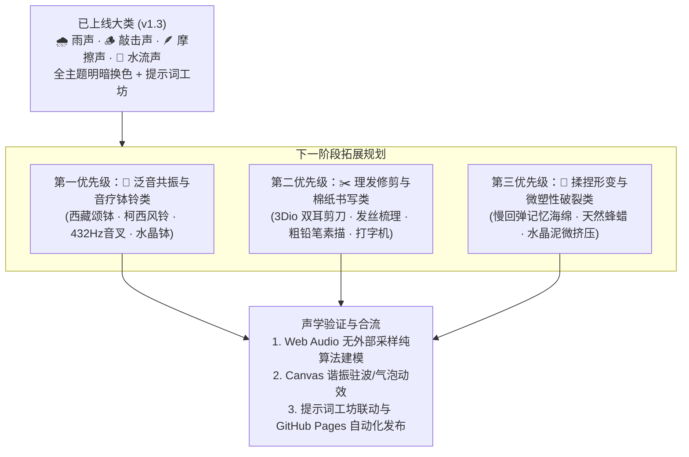

# AI-ASMR 沉浸式声音实验室：声音大类拓展与声学工程规划

- 文档日期：2026-10-24
- 项目路径：`projects/ai-asmr/index.html`
- 技术栈：纯原生 HTML5 / CSS3 / ES2022 Vanilla JavaScript + Web Audio API + Canvas 2D
- 设计基准：零外部依赖、纯本地实时算法合成、双耳 3Dio 假人头立体声学、全主题自适应（默认深色 / 默认浅色 / 瑞士网格 / 深空终端 / 极简单色）

---

## 1. 现有成果与基石声学回顾

AI-ASMR 声音实验室已上线四大核心基石大类，建立了零外部音频文件的纯原生程序化声学物理合成链路：

| 现有大类 | 物理声学机制 | 材质 / 场景覆盖 | 3Dio 空间与动效 |
| :--- | :--- | :--- | :--- |
| **🌧️ 降水天气类 (Rain & Weather)** | 独立立体声去相关粉噪/褐噪 + 窄带阻尼带通滤波（双层隔音玻璃、桧木屋檐、帆布帐篷、阔叶） | 微雨、小雨、大雨、倾盆大雨、远雷暴风雨 | 雨丝下落、地面同心涟漪粒子、双耳声像微晃 |
| **🪵 刚体空腔敲击类 (Tapping Triggers)** | 双阶正弦腔体谐波（主谐频 210Hz~780Hz）+ 3~6ms 软淡入包络（彻底抹除点击直角毛刺） | 天然空心木盒、精装书皮、软硅胶吸音块、厚陶马克杯、天然竹节 | 慢速点敲、指尖微颤连轮敲、双耳轨道穿梭、催眠 60 BPM 节拍 |
| **🪶 接触剪切摩擦类 (Friction & Swiping)** | 4 秒无缝立体声粉红噪声 + 呼吸式升余弦推抚增益包络 + 190Hz~450Hz 温润受力峰值滤波 | 蓬松软毛刷、细腻天鹅绒、细腻微砂台、温暖指腹轻摩、复古厚书页 | 往复推抚、3Dio 耳廓打圈、羽化轻短拂、绵延沉浸长抚 |
| **🫧 自然水相流体与水流声类 (Water Flow & Bubbles)** | Minnaert 气泡共鸣向上微扫频 + 流体湍流微扰动带通滤波 + 周期性日式添水竹筒沉闷叩石 | 山涧清泉、鹅卵石浅溪、幽潭微涌、粘稠微气泡、添水竹韵 | 水面流动波光、升腾微气泡与破裂涟漪、3Dio 双耳洄游与拍浪起伏 |

---

## 2. 尚未涉及的 ASMR 核心大类全景盘点

为了构建工业级完整的 ASMR 声音矩阵，对尚未覆盖的 5 个专业声音大类进行系统化声学解构：

### 2.1 🔔 能量泛音与音疗钵铃类 (Singing Bowls, Chimes & Tuning Forks)
- **听感特征**：纯正正弦波高阶谐波，极长的 10~20 秒自然指数衰减尾音，极度适合深度睡眠诱导、冥想、瑜伽与脑电波慢波（Theta/Delta）同步。
- **代表触发音**：
  - **西藏颂钵轻叩与环磨 (Tibetan Singing Bowl)**：深沉 Sub-bass 基频（108Hz / 216Hz / 432Hz）伴随缓慢旋转的共鸣环唱；
  - **柯西风铃 (Koshi Bamboo Chimes)**：多根不同音律精密竹管在微风中轻触，空灵清透；
  - **疗愈音叉 (Healing Tuning Forks)**：纯正弦双耳微频差（产生 4Hz~8Hz 双耳节拍 Binaural Beats）；
  - **水晶钵回旋 (Crystal Quartz Bowl)**：高纯度光环微回荡。
- **工程实现友好度**：⭐⭐⭐⭐⭐（极高）。Web Audio API 的 `OscillatorNode` + 高 Q 值 `BiquadFilterNode` 天然适合程序化数学拟合，零失真、零噪声底。

### 2.2 🫧 水相流体与微气泡类 (Fluid, Bubbles & Droplets)
- **听感特征**：湿润、流动、包裹感，不同于广义降水天气，专注于水体自身的受力形变与近距离水分子微扰动。
- **代表触发音**：
  - **粘稠微气泡翻滚 (Gentle Viscous Bubbles)**：在浓稠液体中缓慢升起并轻破的软钝气泡声；
  - **山涧石缝清泉缓流 (Mountain Spring Trickle)**：细流在圆润鹅卵石缝隙间漫过的水波微花；
  - **威士忌冰块慢融 (Melting Ice Clink in Tumbler)**：厚底玻璃杯中大方冰微微碰撞与融水微裂；
  - **日式添水竹筒 (Shishi-odoshi)**：清泉细水注满竹筒，而后“咚”的一声沉闷落石倾泄。
- **工程实现友好度**：⭐⭐⭐⭐（高）。通过高斯扫频正弦小脉冲（Sine Chirps）可精准建模单个微气泡破裂的频率上升包络（Minnaert 气泡谐振公式）。

### 2.3 ✂️ 日常工具、理发与微机械类 (Tools, Grooming & Typewriter)
- **听感特征**：伴读、专注与高安全感日常仪式感（如深夜自习室或经典美发沙龙场景）。
- **代表触发音**：
  - **近耳理发剪刀空剪 (Binaural Haircut Scissors)**：锋利剪刀在 3Dio 假耳两侧开合掠过的气流与刀刃滑动的金属微脆音；
  - **木梳梳理发丝 (Hair Brushing & Combing)**：宽齿木梳或细密鬃毛梳划过发丝的连绵沙沙微流；
  - **重质石墨铅笔在棉纸上书写 (Pencil Scratch on Cotton Paper)**：沉稳、有节奏的书写停顿与笔尖微阻力；
  - **复古机械打字机 (Vintage Typewriter)**：铅字臂轻击色带的清脆钝音与慢速回车铃。
- **工程实现友好度**：⭐⭐⭐⭐（高）。需格外控制 6kHz 以上泛音，防止金属刀刃变为工业高频噪音。

### 2.4 🧼 揉捏形变与微塑性破裂类 (Squish, Crinkle & Memory Foam)
- **听感特征**：具有强烈的触觉联觉（Tactile Synesthesia），听觉直接刺激大脑产生被软组织包裹的下沉回弹感。
- **代表触发音**：
  - **慢回弹记忆海绵 (Memory Foam Slow Rebound)**：被深压到底后，数万微气孔缓慢吸气舒展的微气流形变；
  - **温热天然蜂蜡/橡皮泥揉捏 (Warm Beeswax Kneading)**：慢速揉压折叠时的深层柔润阻尼声；
  - **柔软史莱姆/水晶泥微气泡 (Soft Slime Micro-pops)**：软胶拉伸时极微弱的微气泡钝感挤压；
  - **轻柔烘焙油纸/亚麻布揉捏 (Soft Parchment / Linen Crinkle)**：柔和微沙的纤维褶皱声，杜绝塑料纸尖叫。
- **工程实现友好度**：⭐⭐⭐（中高）。关键在于彻底去除直角脉冲，只保留低通软化后的微瞬态。

### 2.5 🔥 暖冬壁炉与自然有机物碎裂类 (Campfire, Wood Crackle & Forest)
- **听感特征**：高密度微小泊松事件分布（Poisson Process），伴随温暖壁炉与森林深沉包裹感。
- **代表触发音**：
  - **松木壁炉炭火慢爆 (Pine Fireplace Charcoal)**：深沉木柴燃烧的微弱火苗呼呼声，伴随间歇性深沉闷爆；
  - **秋日踩踏干燥落叶 (Stepping on Autumn Leaves)**：干燥枫叶在鞋底或指尖层层碎裂的松脆声；
  - **夜间营火余烬微风 (Campfire Embers in Wind)**：微弱碳火在夜风吹拂下的明暗忽明与木炭微裂。
- **工程实现友好度**：⭐⭐⭐⭐（高）。通过随机泊松分布发生器与随机带通共鸣滤波即可实现逼真的炭爆微声。

### 2.6 🌬️ 贴耳微气流与温和低语类 (Inaudible Whispering & Warm Breath)
- **听感特征**：最亲密、最贴近耳廓的近讲微声。
- **代表触发音**：
  - **双耳微语低喃 (Inaudible Whispering / Soft Spoken)**：无声带基频、纯口唇气流调制；
  - **温热轻吹假耳 (Gentle Ear Blowing)**：双耳交替的极弱暖风微气流；
  - **干燥近讲微舌音 (Dry Subtle Mouth Sounds)**：无口水黏腻感、无齿音的极微小舌尖气压差。
- **工程实现友好度**：⭐⭐（较低）。人类发音器官极其复杂，完全用无样板算法合成易产生机械人声感，更推荐通过 AI 声学模型（ElevenLabs/AudioLDM）采样驱动。

---

## 3. 声学工程标准与全大类防翻车底线

在后续大类研发中，必须严格恪守以下声学工程防线：

1. **消除一切直角破音 (Zero Hard Click)**：
   所有脉冲与发音单元必须包裹至少 2~8ms 的 `linearRampToValueAtTime` 软淡入上升沿（Soft Attack Envelope）。
2. **严苛的高频钝化天花板 (Dynamic LPF Rolloff)**：
   主总线串联 `BiquadFilterNode(lowpass)`，默认截止频率锁定在 1200Hz~2200Hz 范围，彻底削减 4kHz~12kHz 的尖锐齿音与金属哨鸣。
3. **安全限幅防爆音 (Soft Limiting)**：
   Master Bus 必须前置 `DynamicsCompressorNode`（Threshold -6dB, Ratio 12:1, Attack 0.003s），杜绝突发共振或多轨道叠加导致的数字削波（Digital Clipping）。
4. **3Dio 双耳空间真实度**：
   左右声道声像基于 `StereoPannerNode` 或双声道卷积，模拟 17cm 人头耳距带来的耳间时间差（ITD）与耳间强度差（IID）。

---

## 4. 全局主题换色与 Canvas 视口规范

实验室已确立全套明暗主题无缝适配协议，新大类必须遵循：

1. **视口背景动态映射**：
   - 深色体系（Dark / HUD）：`radial-gradient(circle, #15242b 0%, #0a1114 100%)`；
   - 浅色体系（Light / Swiss / Mono）：`radial-gradient(circle, #edf5f6 0%, #d5e5e8 100%)`。
2. **双套粒子对比色板 (High-Contrast Theme Palettes)**：
   - 深色背景使用高透明亮色粒子（天蓝、青绿、明黄、淡粉）；
   - 浅色背景自动映射为高饱和深色粒子（孔雀蓝、墨绿、琥珀金、深梅粉），确保视觉轨迹清晰分明。
3. **坐标系统解耦与绝对物理清屏**：
   每帧必须执行 `ctx.setTransform(1, 0, 0, 1, 0, 0); ctx.clearRect(0, 0, canvas.width, canvas.height);`，杜绝 Windows 125%~200% DPR 缩放下的边缘像素累积。

---

## 5. 阶段性研发路线图 (Roadmap)

---

## 6. AI 提示词工坊扩展规范

每引入一个新大类，必须配套提供该大类的双语 Prompt 矩阵与高强度负向词：

- **正向提示词基准结构**：
  `ASMR, binaural 3Dio style recording, [style.enName] with [material.enName] in extreme close-up. Delicate micro-textures, ultra-gentle and cushioned dull sound, mellow low-mid acoustic resonance, repetitive and hypnotic cadence. Pure dry studio acoustics, soundproof room, zero reverberation.`
- **负向提示词基准结构 (Negative Prompt)**：
  `harsh transients, sharp clicks, ear-piercing high frequencies, chalkboard screeches, sudden startling pops, digital clipping, distortion, muddy rumbling, loud background hiss, heavy cavernous reverb.`
