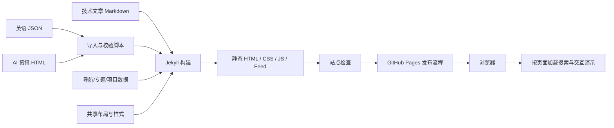

# 个人博客改造调研与设计建议

调研日期：2026-10-17。当前代码基线：4257e58。本文是改造准备方案，尚未修改页面或切换技术栈。

## 1. 建议方向

将网站定位为「嵌入式工程师的技术笔记与实验室」：首页让读者快速理解你研究什么、有哪些值得读的文章、哪些项目可以直接体验。

推荐组合：Anthony Fu 的个人表达 + Julia Evans 的主题索引 + Josh Comeau 的交互讲解。借鉴 Maggie Appleton 的内容成长机制，保留你现有的中文技术内容、深浅主题与项目演示。

第一阶段继续使用 Jekyll、Liquid、原生 CSS/JavaScript 和 GitHub Pages。当前需求首先是信息架构、阅读体验和模板复用，现有技术栈能够完成。仓库 AGENTS.md 也要求在用户明确要求其他技术栈前保持轻依赖。

## 2. 参考网站：观察、架构证据与适用边界

以下「适合借鉴」属于本次设计判断，不是作者对本站的建议。已查看前五个站点的实际桌面页面；技术栈仅在有作者说明或公开源码证据时确认。未运行这些站点的构建、未做移动端或性能跑分。

### Anthony Fu：个人身份与项目表达

- 网站：[antfu.me](https://antfu.me/)。文字居中聚焦，导航与正文分工清楚，个人身份通过具体项目和工作内容建立，而非大段抽象宣言。
- 架构：[package.json](https://github.com/antfu/antfu.me/blob/main/package.json) 显示 Vue、Vite、vite-ssg；[vite.config.ts](https://github.com/antfu/antfu.me/blob/main/vite.config.ts) 显示 Markdown 页面、Shiki、目录和分享图片的构建处理。视觉简洁不代表工程依赖少。
- 适合借鉴：简短自我介绍；项目作为可信证据；清晰的文章/项目入口；克制的强调色。
- 本站落地：用一句具体定位替换泛化的首屏标题，将拉力计演示与相关技术文章串起来。

### Julia Evans：技术内容如何长期可查

- 网站：[jvns.ca](https://jvns.ca/)。首页同时提供近期文章和按主题组织的历史内容，日期与标题形成便于扫描的列表。
- 本次未核实其当前生成器和托管部署链，不能从外观判断技术栈。
- 适合借鉴：主题入口、精选文章、图解和调试记录的表达方式。无需照搬其旧式装饰、配色或很长的首页归档。
- 本站落地：建立 MCU/驱动、嵌入式 Linux、Qt/QML、工业通信四个候选专题；专题同时关联文章和项目。当前仅有 7 篇文章，先做实际有内容的专题，避免空栏目。

### Josh W. Comeau：交互解释与文章阅读

- 网站：[joshwcomeau.com](https://www.joshwcomeau.com/)。文章标题、摘要、分类入口层次鲜明，交互内容是其技术教学的关键。
- 作者的[架构说明](https://www.joshwcomeau.com/blog/how-i-built-my-blog-v2/)介绍 Next.js App Router、React、MDX、Shiki 等，并解释课程平台和交互需求为何影响选型。所列版本是该说明文的记录，不视为生产依赖的实时清单。
- 适合借鉴：让读者动手调整参数来理解原理；良好的代码排版与文章导航；把个性集中在少数细节。
- 本站落地：先用现有拉力计演示建立「文章 → 演示 → 原理说明」路径；后续可做采样/滤波参数对比、DMA 时序解释等独立组件。拟议实验不能作为真实硬件精度证明。
- 取舍：当前内容不需要其完整应用架构、数据库或课程系统。

### Maggie Appleton：持续生长的知识库

- 网站：[maggieappleton.com](https://maggieappleton.com/)。明显的编辑式排版，Essays、Notes、Patterns 等内容类型各有用途。
- 当前[Colophon](https://maggieappleton.com/colophon)和[V3 源码](https://github.com/MaggieAppleton/maggieappleton.com-V3)确认 Astro、MDX 和静态内容文件；V2 的 Next.js 仓库已退役。不要拿旧仓库当现网架构。
- 适合借鉴：区分短笔记、系统教程与持续更新的项目记录；标记内容成熟程度；通过关联内容形成阅读路径。
- 本站落地：增加可选的 updated、series、project、status 字段。status 描述文档完善度；硬件验证结果应另外标注测试条件和证据，不能混为一种状态。
- 取舍：暂不增加知识图谱、全文悬浮预览等复杂交互。其大英文衬线标题也不宜直接套到中文技术文章。

### Dan Abramov / overreacted：把注意力留给文章

- 网站：[overreacted.io](https://overreacted.io/)。窄内容列、大标题、日期和短摘要构成清晰的文章列表，几乎没有外围信息干扰。
- [公开 package.json](https://github.com/gaearon/overreacted.io/blob/main/package.json)包含 Next.js、React、MDX 渲染和 Shiki。这里只确认仓库依赖，未核实当前托管与运行模式。
- 适合借鉴：列表页的排版节奏、可点击标题、去除无用容器。
- 本站落地：技术笔记使用紧凑列表；项目保留图像和演示入口。不同内容使用适合各自用途的布局。

### Hux Blog：与现有 Jekyll 技术栈直接对照

- [原博客](https://huxpro.github.io/)及[公开仓库](https://github.com/Huxpro/huxpro.github.io)适合研究 Liquid 模板、归档、搜索索引及主题组织。仓库保留 Jekyll 体系，作者也指出部分构建方式较旧。
- 注意：huangxuan.me 当前跳转到 hux.pro，已经是另一种个人主页。不能将旧主题架构与新主页混淆。
- 适合借鉴：Jekyll 下如何组织博客功能；不建议整套引入其历史 Grunt/LESS 工具链。本次未做该站截图级视觉核查。

## 3. 本站现状与需要优先解决的问题

### 已确认的基础

- `_config.yml`：Jekyll collections 管理 articles 与 english；文章固定在 `/articles/:name.html`；jekyll-feed 负责订阅输出。
- 当前有 7 篇技术文章、11 个英语条目；项目索引现有一个数显式拉力计演示。
- 英语 JSON 经导入脚本生成 `_data/english/` 与 `_english/`；AI 资讯采用独立 HTML 与 `_data/ai_news.json` 索引。
- `assets/css/base.css` 已有颜色变量；`theme.js` 支持颜色模式；文章已有目录、复制代码、阅读进度和相邻文章。
- `.github/workflows/site-quality.yml` 执行严格 Jekyll 构建及 `scripts/check-site.mjs`。这份 workflow 是质量检查；本文没有核实 GitHub Pages 后台发布源设置，不能将它称为已验证的部署流水线。

### UI 与内容组织

1. 首页 `.hero` 使用接近一整屏的高度，现场桌面截图中首屏主要是泛化标题、每日一句和装饰插画，具体文章与项目需要继续向下寻找。建议缩短介绍区，露出精选文章和项目。
2. 英语、AI 资讯、项目置于笔记前方。建议原创技术内容优先，日常内容集中成次级入口；这是结合工程师博客定位提出的顺序，尚不是用户确认的偏好。
3. 分类中「嵌入式」与「嵌入式 Linux」存在范围包含关系。建议用明确主分类与多个细标签，避免一篇文章的归属取决于历史写法。
4. 首页导航包含文章、项目、英语、AI 资讯、联系、RSS、GitHub 和主题控件。建议主导航精简，RSS、GitHub、联系方式移至合适的辅助区域。
5. 正文目前在带边框的 `.content` 容器中。建议优先加强中文行距、段落间距、代码表格可读性，弱化整篇文章的卡片外壳。

### 模板与工程组织

1. `index.html`、`_layouts/frame.html`、`_layouts/article.html` 重复 head、导航与大量样式。共享 CSS 变量已经有了，但共享页面壳仍不完整。
2. 首页分类、文章目录/复制代码等行为仍含内联脚本，适合按职责提取。
3. AI 资讯 HTML 独立生成，主题与版式容易和博客分离；未来应明确公共外壳及导入契约。现有导入器刻意让日报 HTML 不经过 Liquid，改造时不能无意改变这一行为。
4. 从本次检查的首页与模板未发现站内全文搜索；现有分类筛选只处理首页文章。先做标题、摘要、标签搜索已经足够有用。

## 4. 推荐的信息架构与 UI 规格

主导航候选：`首页 / 文章 / 项目 / 日常 / 关于`，搜索和主题作为工具入口。日常页聚合每日英语、每日一句和 AI 资讯，但保留原地址与归档。

首页结构从上往下：

1. 简短介绍：single5240，嵌入式开发、Linux 与 Qt 实践；主要操作为「读文章」「看项目」。
2. 精选文章：人工选择 2–3 篇，用具体摘要解释读后能解决什么问题；没有流量统计时不要叫「热门」。
3. 项目展示：拉力计截图、解决的问题、关键技术、演示入口、相关文章。用实际图像建立个人识别度。
4. 最新笔记：紧凑列表，显示日期、标题、一句话摘要和主题。
5. 日常更新：英语与 AI 资讯的简短入口。
6. 页脚：关于、RSS、GitHub、公开联系方式。

候选视觉基线（设计建议，待原型验证）：

- 总体：安静的工程笔记风格，浅色使用暖白/中性色，深色使用低饱和深灰，继续沿用青色强调。
- 中文正文：桌面约 18px、手机约 16–17px，行高约 1.8；正文列约 720–780px，按实际中文阅读效果调整。
- 页面：列表页以文字为主，项目页使用图文；空隙体现层级，少量边框负责分组。
- 文章：标题、摘要、发布日期/更新日期、标签、适用环境；宽屏可用侧边目录，手机使用可折叠目录。
- 代码与表格：复制反馈、横向滚动、清楚的语言标识；不要让整页跟随代码横向溢出。
- 动效：只用于反馈和必要过渡；保留 prefers-reduced-motion、键盘焦点和跳转正文入口。
- 首屏：在 1366×768 桌面布局中展示具体内容入口；手机中尽早看到文章/项目入口。通过原型截图验收，而非仅凭 CSS 数值判断。

## 5. 推荐架构：先整理现有静态系统



上图是目标流程。当前质量检查与 Pages 发布是否形成强制门禁仍需核实，实施时应确保检查通过的产物才部署，避免质量检查与默认发布并行而无法阻止失败上线。

建议拆分：

```text
_includes/
  head.html             # 统一元信息与主题初始化顺序
  header.html
  footer.html
  article-item.html
  project-card.html
_layouts/
  default.html          # 页面公共外壳
  home.html
  article.html
  frame.html
  english.html
_data/
  navigation.yml
  topics.yml
  projects.yml
assets/css/
  base.css              # 颜色、字体、间距和基础组件
  home.css
  article.css
assets/js/
  theme.js
  article.js
  search.js
```

这是一份目标结构，不要求机械增加全部文件。先消除真实重复，保持主题脚本先于 CSS、保留共享资源版本参数、保留 Jekyll URL filters。

搜索先在构建时输出文章元信息 JSON，浏览器按需加载，用原生 JS 做标题/摘要/标签筛选；无 JavaScript 时归档与专题页仍可浏览。中文检索先做包含匹配并明确范围，不直接承诺分词或全文效果。未来内容规模与实测延迟需要时，再评估静态全文索引。

项目演示维持独立路径和独立脚本，项目入口页使用统一网站外壳；240×320 模拟屏、字体与测试逻辑保持内部边界，避免全站 CSS 污染演示。首页只加载预览图，用户打开项目后再加载模拟器。

### 什么时候考虑 Astro

当多篇文章都需要复用交互组件、内容模型校验成为明显负担，或希望将构建工具统一到 Node 时，再单独提出 Astro 迁移方案。Astro 的 islands 机制允许静态内容与局部客户端交互共存，见[官方说明](https://docs.astro.build/en/concepts/islands/)。

迁移代价包括 Liquid 转换、内容和 URL 兼容、导入脚本适配、Feed/sitemap、部署与回归。当前没有测量证明迁移会让本站更快，不能把换框架当作性能结论。Next.js 更适合未来确有账号、个性化或服务端动态能力的需求；目前没有这类已确认需求。

## 6. 实施顺序与验收

### 第一步：可比较的原型

做一个首页和一篇真实长文的桌面/手机原型；提供浅色与深色。先验证文字密度、中文排版和项目呈现。风格可比较「简洁个人主页」和「技术笔记 + 实验室」两个版本，推荐后者。

### 第二步：公共外壳与首页

抽取 head/header/footer，统一导航和设计变量；缩短首页介绍，重排精选文章、项目和日常内容。保留旧文章地址、首页关键锚点或提供兼容跳转。具体改造使用独立分支，先审阅预览再上线。

### 第三步：文章与内容发现

优化文章模板、目录、代码与表格；增加归档/专题和轻量搜索；补全项目关联与更新日期。现有文章缺少新字段时提供兼容默认值，避免必须先迁移全部内容。

### 第四步：统一日常内容与自动化

整理英语/AI 日报的导入契约与公共导航；核实 Pages 实际发布设置，将构建和站点检查绑定到发布门禁。

### 验收清单

- `bundle exec jekyll build --strict_front_matter`、`node scripts/check-site.mjs`、编辑过的 JS 语法检查及 `git diff --check`。
- 360/390px 手机、768px 平板、1366px 桌面，无整页横向溢出；代码块内部允许滚动。
- 浅色、深色、系统主题、首次加载无明显错误主题闪烁。
- 键盘可操作导航/搜索/目录，焦点可见；降低动态效果偏好生效。
- 现有文章、英语、日报和演示地址仍可访问；canonical、Feed、sitemap 与内部链接完整。
- 拉力计演示验证按键/触摸、记录和校正等关键路径，区别自动测试与浏览器实测结果。
- 性能在同样设备和网络条件下做前后比较；本次未做跑分，不声称已有提升。

## 7. 本次工作边界

已完成：参考站点检索、五个站点与本站桌面视觉观察、公开架构资料核对、本地模板/配置/导入与检查流程的源码梳理、改造建议。

待后续实施：视觉原型、移动端实测、性能基线、完整本地构建、真实 Pages 发布设置核查。

本次只生成调研文档；没有改动网站页面，没有提交、推送或部署。
